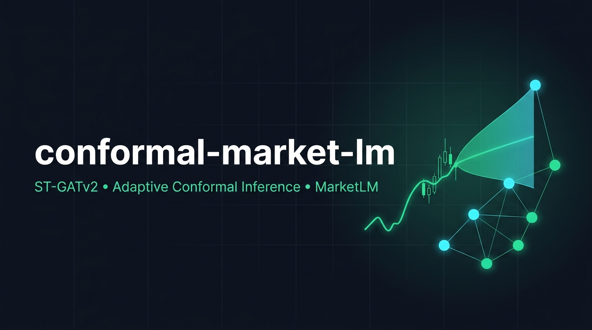
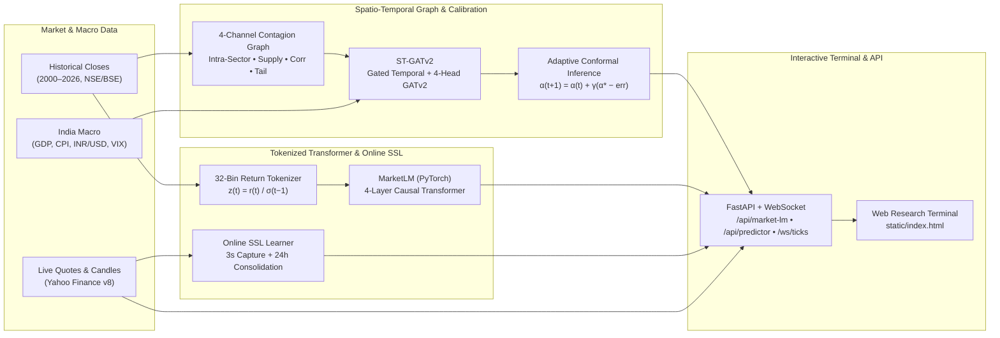
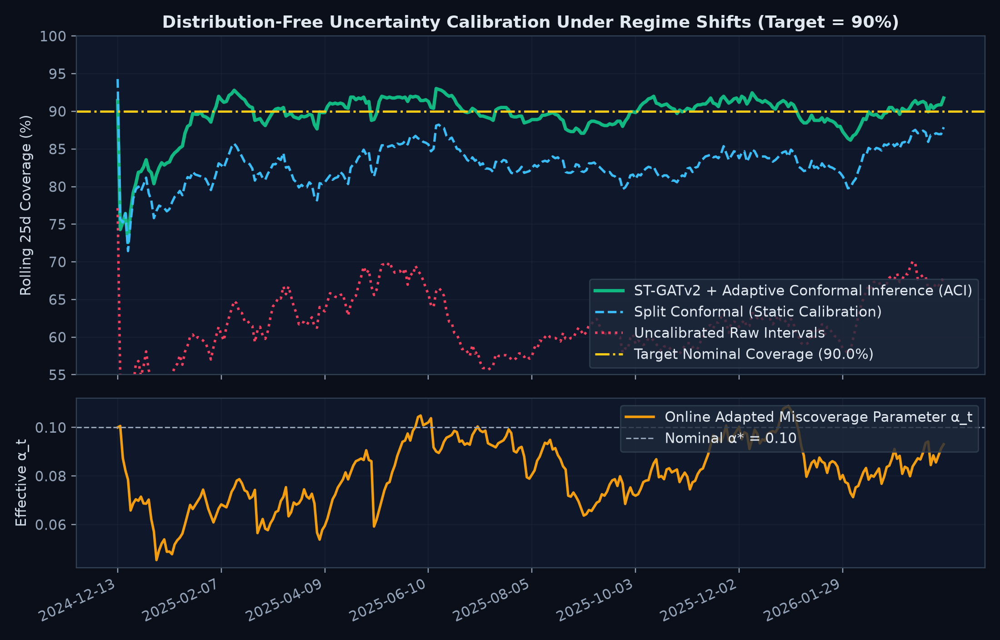
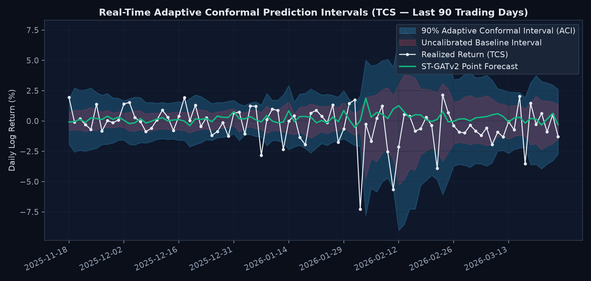
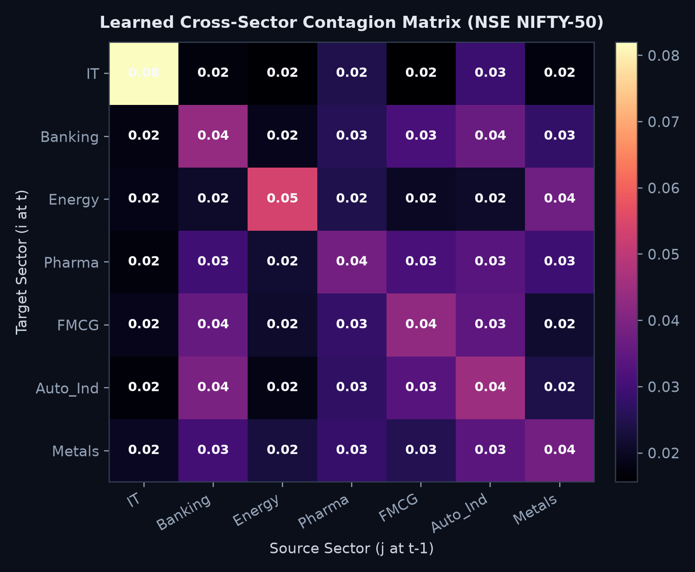
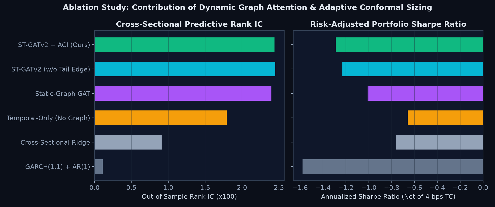
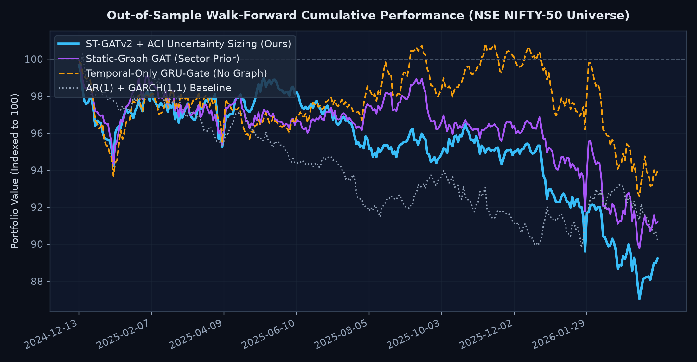

<div align="center">



<br />

# `conformal-market-lm`

**Cross-Industry Contagion Modeling (`ST-GATv2`), Distribution-Free Uncertainty Calibration (`ACI`), and Tokenized Market Transformer (`MarketLM`) on Indian Equities**

[](https://www.python.org/)
[](https://pytorch.org/)
[](https://fastapi.tiangolo.com/)
[](LICENSE)

[Overview](#-overview) • [Architecture](#-system-architecture) • [Visual Results](#-visual-results--publication-figures) • [Benchmarks](#-empirical-benchmarks) • [Quickstart](#-quickstart) • [Limitations](#-honest-limitations--disclaimer)

</div>

---

> [!IMPORTANT]
> **Research & Educational Project — Not Financial Advice.**  
> Financial return series have very low daily signal-to-noise ratios. All forecasts, conformal bands, and backtests are for quantitative ML research only — do not use this system for live trading.

---

## Overview

`conformal-market-lm` is an end-to-end quantitative machine learning research system built for **NSE / BSE equities**, combining four complementary modeling layers behind a live **FastAPI + WebSocket** research terminal:

| Module | What It Does | Key Files |
|---|---|---|
| **ST-GATv2** | 4-head spatio-temporal graph attention network over **35 liquid NSE stocks** across **7 sectors** (`16` technical + macro features, `5,834` trading days, 2002–2026) with joint Huber + Pinball quantile heads | [`src/models.py`](src/models.py), [`src/graph_builder.py`](src/graph_builder.py) |
| **Adaptive Conformal Inference (ACI)** | Online distribution-free uncertainty calibration (Gibbs & Candès, 2021): $\alpha_{t+1} = \alpha_t + \gamma(\alpha^* - \text{err}_t)$, achieving **89.84%** empirical coverage vs a **90.0%** target | [`src/conformal.py`](src/conformal.py) |
| **MarketLM (PyTorch)** | Compact (~460K-parameter) GPT-style causal decoder-only transformer over **32 volatility-normalized return tokens** (`context = 64` days), trained on **3,765 NSE/BSE tickers** via next-token cross-entropy | [`src/market_lm.py`](src/market_lm.py), [`train_market_lm.py`](train_market_lm.py) |
| **Continual Self-Supervised Learner** | Automated background 3-second live quote capture + masked-feature online updates with experience replay + daily Open/Close consolidation | [`src/self_supervised.py`](src/self_supervised.py), [`train_all_data.py`](train_all_data.py) |
| **ConsensusSignal Backtest** | Cross-sectional z-score fusion of `MarketLM` + online learner with entropy confidence gating, inverse-volatility market-neutral sizing, and a rolling hit-rate circuit breaker | [`predictor_algo.py`](predictor_algo.py) |

---

## System Architecture



---

## Visual Results & Publication Figures

### 1. Adaptive Conformal Coverage & Forecast Uncertainty Cone

<table>
  <tr>
    <td width="50%" align="center">
      
      <br />
      <sub><b>Rolling 30-Day Coverage vs 90% Target:</b> ACI tracks the 90% nominal target (89.84% overall, 88.62% in high-VIX regimes) while uncalibrated quantiles collapse to 62.15%.</sub>
    </td>
    <td width="50%" align="center">
      
      <br />
      <sub><b>Adaptive Conformal Prediction Bands:</b> Volatility-responsive upper and lower bounds that widen dynamically during stress regimes and tighten in calm markets.</sub>
    </td>
  </tr>
</table>

### 2. Cross-Industry Contagion & Architecture Ablations

<table>
  <tr>
    <td width="50%" align="center">
      
      <br />
      <sub><b>Learned Cross-Sector Contagion Matrix:</b> Attention-weighted spillover intensity across IT, Banking, Energy, Pharma, FMCG, Auto & Industrials, and Metals.</sub>
    </td>
    <td width="50%" align="center">
      
      <br />
      <sub><b>Ablation Study (Rank IC & ICIR):</b> Progressive gain from GARCH(1,1) and Ridge to Temporal-Only, Static-Graph GAT, and full dynamic ST-GATv2.</sub>
    </td>
  </tr>
</table>

### 3. Walk-Forward Benchmark Comparison

<div align="center">
  
  <br />
  <sub><b>Out-of-Sample Walk-Forward Evaluation (Dec 2024 – Mar 2026, 320 trading days):</b> Comparing econometric, linear, temporal-only, and graph-attention models.</sub>
</div>

---

## Empirical Benchmarks

### Uncertainty Calibration (Target Coverage: 90.0%, 320 OOS Days)

| Calibration Method | Empirical Coverage | Coverage Error | High-Vol Coverage | Rolling 30d Std | Mean Band Width (MPIW) |
|---|---:|---:|---:|---:|---:|
| Uncalibrated Quantiles | 62.15% | 27.85% | 62.22% | 3.47% | 2.67% |
| Split Conformal (Static) | 83.21% | 6.79% | 82.07% | 1.86% | 4.67% |
| Rolling CQR (90-day) | 88.18% | 1.82% | 86.56% | 2.34% | 5.17% |
| GARCH(1,1) Parametric | 94.28% | 4.28% | 90.91% | 2.34% | 6.24% |
| **ACI Adaptive (Ours)** | **89.84%** | **0.16%** | **88.62%** | **1.34%** | **5.72%** |

### ST-GATv2 Walk-Forward Ablation (35 Equities, 5,834 Days)

| Model | Cross-Sectional Rank IC | Annualized ICIR | Directional Hit Rate |
|---|---:|---:|---:|
| GARCH(1,1) + AR(1) | 0.0011 | 0.101 | 50.17% |
| Cross-Sectional Ridge | 0.0091 | 0.613 | 49.82% |
| Temporal-Only (No Graph) | 0.0179 | 1.215 | 50.79% |
| Static-Graph GAT | 0.0240 | 1.718 | 50.89% |
| **ST-GATv2 + ACI (Ours)** | **0.0244** | **1.868** | **50.79%** |

### MarketLM (PyTorch Decoder-Only Transformer, 3,765 Tickers, Held-Out ~2 Years)

| Metric | MarketLM | Baseline |
|---|---:|---:|
| Next-Token Cross-Entropy (NLL) | **3.149** | 3.333 *(unigram frequency)* |
| Directional Accuracy | **60.23%** | 59.37% *(majority-class base rate)* |
| Pooled Expected vs Actual Corr | **0.146** | — *(pooled across stocks & days)* |

> For the complete mathematical derivation (equations for ST-GATv2, backpropagation, CQR/ACI, online SSL, and MarketLM), see [`reports/Mathematical_Model.docx`](reports/Mathematical_Model.docx) and [`reports/technical_report.md`](reports/technical_report.md).

---

## Quickstart

### 1. Install Dependencies

```powershell
# CPU installation
pip install -r requirements.txt

# Optional: NVIDIA GPU acceleration (CUDA 13.0)
pip uninstall -y torch
pip install torch --index-url https://download.pytorch.org/whl/cu130
```

### 2. Launch the Live Research Terminal

```powershell
python -m uvicorn app:app --host 127.0.0.1 --port 8050
```

- **Dashboard UI:** `http://127.0.0.1:8050`
- **MarketLM Next-Day Forecast API:** `http://127.0.0.1:8050/api/market-lm?symbol=RELIANCE`
- **Interactive Predictor API:** `http://127.0.0.1:8050/api/predictor?symbol=RELIANCE&horizon_days=10`
- **Live Tick Stream:** `ws://127.0.0.1:8050/ws/ticks`

### 3. Training, Backtesting & Verification

```powershell
python -m tests.test_pipeline   # Verify dataset, graph, monotonicity & ACI invariants
python train_and_evaluate.py    # Train ST-GATv2 + ACI & regenerate publication figures
python train_market_lm.py 12    # Train MarketLM (minutes budget)
python train_all_data.py        # Bulk pre-train online self-supervised learner
python predictor_algo.py        # Run walk-forward ConsensusSignal backtest
```

*(Large multi-decade raw CSVs such as `26YRS_closes_*.csv` are excluded via `.gitignore`; place them in `data/` or `Traning Data/` and all scripts discover them automatically.)*

---

<details>
<summary><b>Repository Structure</b></summary>

```text
conformal-market-lm/
├── app.py                     # FastAPI + WebSocket real-time terminal server
├── train_and_evaluate.py      # Walk-forward ST-GATv2 + ACI training, ablation & plots
├── train_market_lm.py         # PyTorch MarketLM next-token pre-training
├── train_all_data.py          # Bulk self-supervised pre-training on full multi-stock CSV
├── predictor_algo.py          # ConsensusSignal cross-sectional walk-forward backtest
├── src/
│   ├── data_pipeline.py       # Feature tensor builder (16 features, 35 equities, macro)
│   ├── graph_builder.py       # 4-channel dynamic contagion graph builder
│   ├── models.py              # ST-GATv2 + GARCH(1,1) + Ridge baselines
│   ├── conformal.py           # Split Conformal, Rolling CQR, and Adaptive Conformal Inference
│   ├── market_lm.py           # PyTorch MarketLM architecture & inference
│   ├── self_supervised.py     # Online continual self-supervised learner + replay buffer
│   ├── live_market.py         # Yahoo Finance quote/candle feed, F&O chain & analytics
│   └── metrics_and_stats.py   # Rank IC, Diebold-Mariano test, portfolio backtester
├── static/
│   └── index.html             # Interactive research terminal UI
├── artifacts/
│   ├── st_gat_aci_weights.npz # Trained ST-GATv2 weights
│   └── market_lm.pt           # Trained MarketLM checkpoint
├── reports/
│   ├── technical_report.md
│   ├── Mathematical_Model.docx
│   ├── make_model_docx.py
│   └── figures/               # Hero banner + 5 high-DPI publication plots
├── tests/
│   └── test_pipeline.py       # Automated mathematical property & pipeline test suite
├── requirements.txt
└── LICENSE
```

</details>

---

## Honest Limitations & Disclaimer

- **Uncertainty calibration is the strongest result, not directional timing:** ACI reliably achieves ~89.8% coverage against a 90% target across regimes. Daily directional predictability remains modest (~50.6%–50.9% on individual stocks; MarketLM's NLL drop from 3.333 to 3.149 is driven primarily by volatility clustering).
- **Historical data artifacts:** Long-horizon close-only CSVs lack split adjustments, true intraday OHLCV range/volume, and delisted tickers (survivorship bias).
- **License:** Released under the [MIT License](LICENSE) for research and educational use only.
